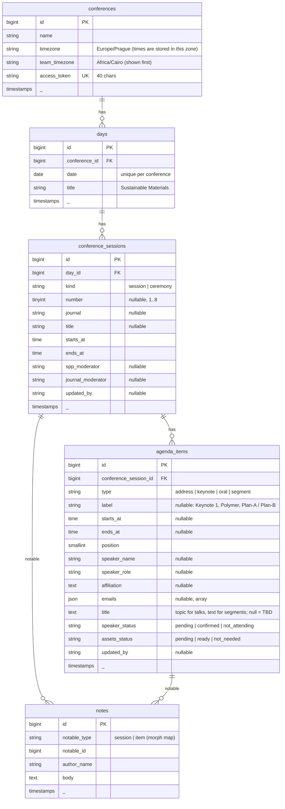

# SPP Conference Manager — System Design

> Living reference for building and running the team schedule board for the
> Science Park Publisher (SPP) online conference, 24–25 October 2026.
> Update this file whenever a decision changes.

---

## 1. Problem & Goal

The SPP team (researchers + 3 IT specialists acting as Zoom hosts) prepares a
two-day online conference with 8 journal sessions and 38 speakers. Today the
schedule lives in a PDF that is edited, re-exported and re-posted to a WhatsApp
group after every change (we are on draft 8). Google Docs is live but has no
structure: you can't filter it, and statuses are just highlighted text.

**Goal:** one shared link where everyone sees the same schedule. Anyone can
update a speaker's confirmation, the assets status, the moderators, or add a
note in one or two clicks, and every change shows who made it.

### Who uses it

| Person | What they need |
|---|---|
| Researchers | Contact keynotes, mark Confirmed / Not attending, collect assets, assign moderators, leave notes |
| IT specialists (Zoom hosts) | See which assets are ready, and which speakers are absent so IT presents their assets instead |
| Coordinators | Overview: what is still pending, what is at risk |

The team works from Egypt, while the official programme is printed in Prague
time. The app therefore shows **every time in both Cairo and Prague**.

### Glossary

| Term | Meaning |
|---|---|
| SPP | Science Park Publisher, the organizer |
| SPP moderator | SPP staff member who runs a session (e.g. Sara Ayman) |
| Journal moderator | Editor from the session's journal who moderates alongside SPP |
| Keynote | 15-minute invited talk |
| Assets | PowerPoint slides / videos played in the session; IT presents them if the speaker is absent |
| Plan-A / Plan-B | Fallback slot: discussion if time allows, otherwise poster video-graph |

---

## 2. Decisions

| Topic | Decision | Why |
|---|---|---|
| Name | **SPP Conference Manager** (app). The event is seeded as "SPP Online Conference 2026" | Requested |
| Access | One **secret team link** per conference (`/s/{token}`); no login | Fastest to share in WhatsApp; the 40-char token can't be guessed |
| Identity | Ask for the editor's name **once per device**, keep it in a long-lived cookie, show "Editing as Sara · change" | Every change is attributed without asking on every click |
| Live updates | **None.** Data refreshes after your own edits, on page reload, or with the Refresh button | Edit volume is low; avoids websockets and polling |
| Assets | **Status only**, two states: *Pending* / *Ready*. Team rule: set Ready only after confirming the files were received | Simple; files stay where the team already keeps them |
| Times | **Cairo and Prague side by side** everywhere (Cairo first, bold) | Team works from Egypt; programme is in Prague time; clocks change between Day 1 and Day 2 |
| Zoom hosts | No per-session IT host field | The 3 IT specialists work together with flexible shifts |
| Filters | Day → dependent Session, speaker search, speaker status, assets status. Kept in the URL | Shareable views, e.g. send IT "Day 2 · assets pending" |
| Scope | Built for this conference; the data model supports adding another conference later | No rewrite needed next time, no admin panel now |
| Schedule editing | Seeded from the PDF; the team can add, edit and delete sessions and items in the app | The PDF keeps changing |
| Hosting | Shared hosting or VPS. PHP + MySQL only at runtime: no Node server, no queue worker, no websockets | Works anywhere; SSR is disabled |
| Stack | Laravel 12 · Inertia v3 · Svelte 5 (runes) · TypeScript 6 · Tailwind v4 · Vite 8 · MySQL | Requested; current stable versions |

### Out of scope (on purpose)

User accounts and roles · real-time sync · file uploads · full activity history
· sending emails to speakers · drag-and-drop reordering · multiple languages ·
admin panel (conferences are created with a seeder/artisan) · per-session Zoom host.

---

## 3. UX Design

### 3.1 Principles

1. **One page.** The whole conference is a single scrollable agenda, so there are no pages to navigate between.
2. **Status sits next to the record**, as on the PDF screenshot: each speaker row has a status column on the right.
3. **One click to change a status.** Click the pill, pick the new value, done. No forms for the common action.
4. **Problems stand out.** Neutral by default. Color appears only where action is needed (pending, at risk, missing moderator, topic TBD).
5. **Never lose an action.** If the editor name is missing, the name modal opens first and the original action then continues automatically.
6. **No time-zone math for the team.** Cairo time is always shown first, with Prague below it.

### 3.2 Page anatomy (desktop)

```
┌───────────────────────────────────────────────────────────────────────────────┐ dark navy band
│ [SPP logo] │ CONFERENCE MANAGER                           Editing as Sara ▾   │ (logo has a
│                                                                               │  white wordmark)
│ TEAM SCHEDULE BOARD                                                           │
│ SPP Online Conference 2026                                                    │
│ 24–25 October 2026 · Online via Zoom                     Loaded 10:42 Refresh │
│  ┌──────────────────────────────────────────────────────────────────────────┐ │
└──│ Speakers confirmed │ Assets ready │ Not attending │ At risk │ Topics TBD │ │─┘ summary card
   │ 18/38 ▬▬▬▬         │ 9/38 ▬▬      │ 2             │ 1       │ 6          │ │  overlaps band
   └──────────────────────────────────────────────────────────────────────────┘
   ┌ TIME ZONES ─ Every time is shown twice: Cairo first, then Prague… Day 1     ┐
   │ Cairo is 1 hour ahead (Prague UTC+2); Day 2 Cairo is 2 hours ahead (UTC+1). │
   └─────────────────────────────────────────────────────────────────────────────┘
   [ All | Day 1 | Day 2 ]  [ Session: All ▾ ]  [ ⌕ Search speaker…   ]   (Phase 3)
   [ Speaker: Any ▾ ]  [ Assets: Any ▾ ]          Showing 6 of 52 · Clear filters

 DAY 1 · SUSTAINABLE MATERIALS                        10:00–16:30 Cairo  UTC+3   (sticky)
 Saturday 24 October                                  09:00–15:30 Prague UTC+2

┌──────────────┬──────────────────────────────────────────┬────────────────────┐
│ 10:30–12:00  │ SESSION 1                                 │ 1 note · Edit      │
│ Cairo        │ Integrated Nano (IN)                      │                    │
│ 09:30–11:00  │ Nanomaterials for Energy Harvesting & …   │                    │
│ Prague       │ SPP MODERATOR  Sara Ayman                 │                    │
│              │ JOURNAL MODERATOR  ● Not assigned (amber) │                    │
├──────────────┼──────────────────────────────────────────┼────────────────────┤
│ 10:30–10:45  │ KEYNOTE 1                                 │ Speaker ● Confirmed│
│ Cairo        │ Prof. Nader Shahata                       │ Assets  ● Pending  │
│ 09:30–09:45  │ Editor-in-Chief · Opens the plenary sess. │                    │
│ Prague       │ Piezoelectric Nanocomposites: Horizon of… │ Notes (2) · Edit   │
│              │ nader83@vt.edu                            │ Noha · 2h ago      │
├──────────────┼──────────────────────────────────────────┼────────────────────┤
│ 10:45–11:00  │ KEYNOTE 2                                 │ Speaker ● Pending  │
│ 09:45–10:00  │ Prof. Veera Rajendran                     │ Assets  ● Pending  │
│              │ [Topic TBD] (amber)                       │                    │
├──────────────┼──────────────────────────────────────────┼────────────────────┤
│ 11:45–12:00  │ PLAN-A / PLAN-B   (muted row)             │                    │
│ 10:45–11:00  │ Plan-A: Discussions & Closing (15 min)…   │                    │
└──────────────┴──────────────────────────────────────────┴────────────────────┘
                                                            + Add item to session
```

- **Header:** dark navy band (the SPP logo has a white wordmark), app name, conference name, dates; later the editor chip and "Loaded HH:MM · Refresh".
- **Summary card:** overlaps the header band. Counts for the current Day/Session scope. From Phase 3, clicking a counter applies the matching filter.
- **Time zones notice:** explains the two times and the clock change. It is generated from the data, so it disappears if both days have the same gap.
- **Day header:** sticky while scrolling through that day, with the day's span in both cities and their UTC offsets.
- **Session block:** time (both cities), number, journal, title, both moderators, notes, Edit.
- **Item row:** three columns (time · details · status). Segments such as Plan-A/Plan-B, orals and closings use the same row, muted, with no status pills. Ceremonies are labelled "Plenary".

### 3.3 Mobile (WhatsApp link opened on a phone)

```
┌─────────────────────────────┐
│ [logo]                Sara ▾│  dark band
│ SPP Online Conference 2026  │
│ ┌─────────────┬───────────┐ │
│ │ Confirmed   │ Assets    │ │  summary: 2 columns
│ │ 0/38        │ 0/38      │ │
│ └─────────────┴───────────┘ │
│ [All|Day 1|Day 2] [Filters 2]│  ← "Filters" opens a bottom drawer (Phase 3)
├─────────────────────────────┤
│ DAY 1 · Saturday 24 October │  sticky
│ 10:00–16:30 Cairo           │
├─────────────────────────────┤
│ 10:30–10:45 Cairo           │
│ 09:30–09:45 Prague          │
│ KEYNOTE 1                   │
│ Prof. Nader Shahata         │
│ Piezoelectric Nanocomp…     │
│ Speaker ● Confirmed  Assets ● Pending
│ Notes (2) · Edit            │
└─────────────────────────────┘
```

On phones the three columns stack: time, then details, then the status pills side by side.

### 3.4 Statuses

| Field | Values | Pill style |
|---|---|---|
| Speaker | **Pending** · **Confirmed** · **Not attending** | amber · emerald · rose |
| Assets | **Pending** · **Ready** (received and with the IT hosts) · *Not needed* (segments, hidden) | amber · emerald |

Derived flags, computed on the client with no database column (`resources/js/lib/stats.ts`):

| Flag | Rule | Display |
|---|---|---|
| **At risk** | Not attending + assets pending | Rose left border on the row + "No assets for IT to present" |
| **IT presents** | Not attending + assets ready | Muted line "IT host presents the assets" |
| **Topic TBD** | Speaker item with no topic | Amber "Topic TBD" (like the yellow highlight in the PDF) |
| **Moderator missing** | Numbered session with an empty SPP or journal moderator | Amber "Not assigned" |

### 3.5 Time display

- Times are **stored once**, in the conference timezone (Prague), exactly as printed in the programme.
- The server converts each time to the team timezone (Cairo) **per day**, because Europe and Egypt change clocks on different dates. In 2026, Prague switches to winter time on Sunday 25 Oct; Egypt switches on Thursday 29 Oct.
- Result for this conference: on **Day 1** Cairo is **1 hour** ahead (Prague 09:00 = Cairo 10:00). On **Day 2** Cairo is **2 hours** ahead (Prague 09:00 = Cairo 11:00).
- Every time cell shows `Cairo` (bold) above `Prague` (muted). Day headers also show the UTC offsets.
- The two cities are configurable per conference (`timezone`, `team_timezone`), so a future conference elsewhere just works.

### 3.6 Interactions (Phases 4–6)

| Action | Interaction |
|---|---|
| Change status | Click pill → small menu (dot + label + one-line hint) → select. Pill dims while saving → toast "Saved". |
| Notes | "Notes (n)" opens a modal: newest first, author + relative time, textarea at the bottom, "Add note". Delete asks for confirmation. Available on items and sessions. |
| Edit item / session | "Edit" opens a right-side drawer with a form. Moderators are edited here. Empty moderator fields show "Assign" as a link into the drawer. |
| Add | "+ Add item to session" at the end of each session; "+ Add session" at the end of each day. Both open the same drawer. |
| Delete | In the drawer footer, with confirmation naming the record ("Delete Keynote 2 – Prof. Veera Rajendran?"). |
| Editor name | First write action without a name → modal "What's your name? It will appear next to your changes." Saved → original action runs. |
| Copy email | Hovering an email shows "Copy" (useful for researchers contacting keynotes). |
| Stale edit guard | If someone changed the record after you loaded the page, saving the drawer shows "Updated by Noha at 10:42 — reloaded the latest version" instead of overwriting. |
| Keyboard | `/` focuses search · `Esc` closes modal/drawer/menu. |

Times are entered in the drawer in **Prague time** (the programme's time); the Cairo time is shown live next to the input.

### 3.7 Filters (Phase 3)

- **Day:** segmented control `All | Day 1 | Day 2`.
- **Session:** select that depends on Day. With Day 1 selected it lists `Session 1 – Integrated Nano` … `Session 5`. With All it lists every session grouped by day. Changing Day resets Session.
- **Search:** matches speaker name, topic and email; case- and accent-insensitive; matches are highlighted.
- **Speaker status** and **Assets status** selects.
- All filters combine with AND. Sessions with no matching items are hidden. When no filter is active, every session is shown.
- State lives in the query string: `?day=1&session=12&q=nader&speaker=pending&assets=pending`. Updated with `replaceState` (no history spam, no server round-trip).
- Empty state: "No items match these filters · Clear filters".
- Filtering runs **client-side** (≈60 rows), so it is instant.

### 3.8 Visual language: official, premium, modern, calm

- **Header:** deep navy band (`ink-950`) carrying the SPP logo, whose wordmark is white. A thin teal→green gradient line taken from the logo closes the band.
- **Typography:** *Source Serif 4* for conference, day, session titles and talk topics (academic, publisher feel). *Inter* for everything else. `tabular-nums` for times. Fonts are self-hosted via Fontsource (no Google Fonts requests).
- **Color:** warm off-white page (`canvas`), white surfaces, hairline warm borders (`line`), ink-navy text. The brand teal/green appears only as accents (header line, kicker label, progress bars, focus). Status colors appear only in soft tinted pills with a small dot.
- **Shape and depth:** `rounded-xl` cards, a single soft shadow on the summary card, almost none elsewhere.
- **Labels:** small caps, letter-spaced labels ("KEYNOTE 1", "SPP MODERATOR") instead of icons.
- **Icons:** about 5 in total (search, chevron, close, refresh, copy), from `@lucide/svelte`. Actions use words ("Edit", "Notes"), not icon buttons.
- **Motion:** 150 ms fades and slides for menus, drawer and toasts only.
- **Accessibility:** contrast ≥ 4.5:1, visible focus rings, status is never conveyed by color alone (always a label), dialogs trap focus.

Tokens live in `resources/css/app.css` (Tailwind v4 `@theme`): `ink-50…950`, `canvas`, `line`, `line-strong`, `brand-300…600`, `brand-teal`, plus the `label-caps` utility.

---

## 4. Architecture

```
Browser (Svelte 5 + TS)  ──Inertia v3──▶  Laravel 12  ──▶  MySQL
  one page: Schedule/Show                 controllers + form requests
  client-side filtering                   Eloquent models + enums + JSON resources
```

- **Inertia v3**: Laravel controllers return `Inertia::render('Schedule/Show', [...])`. Writes are normal Inertia `router.patch/post/delete` calls that redirect back, using `preserveScroll` and `preserveState`. Every write reloads the props, so after each save the editor also sees everyone else's latest changes.
- **No API layer, no queue, no websockets, no SSR.** `QUEUE_CONNECTION=sync`, `INERTIA_SSR_ENABLED=false`.
- **Payload:** the whole conference tree (days → sessions → items → notes) is sent in one prop. It is small (< 100 KB), and loading it all lets filtering and notes work instantly.
- **N+1 safety:** `Model::shouldBeStrict()` outside production. Relations use `chaperone()`, so `item → session → day → conference` is available without extra queries.

### 4.1 Data model



Notes on the model:

- **The table is `conference_sessions`, not `sessions`.** Laravel's database session driver already uses `sessions`, and `Session` would clash with the facade. Model: `ConferenceSession`.
- **Statuses are `string` columns cast to PHP backed enums**, not MySQL `ENUM` columns, so adding a value later doesn't need an `ALTER`.
- **Ordering:** days by `date`; sessions by `starts_at`; items by `starts_at` (nulls last), then `position`. Session 4 orals have no individual times, so `position` keeps them in order. New items get `max(position) + 1`.
- **Speakers are stored on the item, not in a `people` table.** The same keynote doesn't appear twice, so a separate table would only add joins.
- **Attribution:** `updated_by` on sessions and items plus `author_name` on notes, combined with `updated_at`, is enough for "Noha · 2h ago". There is no history table (activity log is out of scope).
- **Day number** ("Day 1") is derived from date order on the client and not stored.
- **Time conversion** lives in `Day::timeRange()` / `Day::utcOffsets()` (Carbon, using the conference and team timezones).
- `Relation::enforceMorphMap(['session' => ConferenceSession::class, 'item' => AgendaItem::class])`.

### 4.2 Enums (PHP ⇄ TypeScript)

```php
enum SpeakerStatus: string  { case Pending = 'pending'; case Confirmed = 'confirmed'; case NotAttending = 'not_attending'; }
enum AssetsStatus: string   { case Pending = 'pending'; case Ready = 'ready'; case NotNeeded = 'not_needed'; }
enum AgendaItemType: string { case Address = 'address'; case Keynote = 'keynote'; case Oral = 'oral'; case Segment = 'segment'; }
enum SessionKind: string    { case Session = 'session'; case Ceremony = 'ceremony'; }
```

The TypeScript mirror lives in `resources/js/types/models.ts`. The key shapes are:

```ts
export interface TimeRange { start: string; end: string; team_start: string; team_end: string } // HH:MM

export interface Day {
    id: number;
    date: string;                                      // "2026-10-24"
    title: string;
    time: TimeRange | null;                            // span of the day's sessions
    utc_offsets: { conference: string; team: string }; // "+02:00", "+03:00"
    sessions: ConferenceSession[];
}

export interface Conference {
    id: number;
    name: string;
    cities: { conference: string; team: string };      // "Prague", "Cairo"
    days: Day[];
}
```

Props keep snake_case end to end (no mapping layer). PHP serializes through
`JsonResource` classes with `JsonResource::withoutWrapping()`, so only the
fields above are exposed (the access token is never sent in props).

### 4.3 Routes

All routes are scoped by the conference token. Write routes (Phase 4+) use the
`editor` middleware and `throttle:60,1`.

| Method | URI | Controller | Purpose | Phase |
|---|---|---|---|---|
| GET | `/` | `Route::inertia('Home')` | Plain page: "This schedule is private" | ✅ 2 |
| GET | `/s/{conference:access_token}` | `ScheduleController@show` | The board | ✅ 2 |
| POST | `/s/{token}/editor` | `EditorController@store` | Save editor name (cookie) | 4 |
| PATCH | `/s/{token}/items/{item}/status` | `AgendaItemStatusController@update` | Quick status change | 4 |
| POST | `/s/{token}/notes` | `NoteController@store` | Add note (`notable_type`, `notable_id`) | 5 |
| DELETE | `/s/{token}/notes/{note}` | `NoteController@destroy` | Delete note | 5 |
| POST | `/s/{token}/sessions` | `ConferenceSessionController@store` | Add session | 6 |
| PUT | `/s/{token}/sessions/{session}` | `ConferenceSessionController@update` | Edit session details and moderators | 6 |
| DELETE | `/s/{token}/sessions/{session}` | `ConferenceSessionController@destroy` | Delete session (and its items) | 6 |
| POST | `/s/{token}/sessions/{session}/items` | `AgendaItemController@store` | Add item | 6 |
| PUT | `/s/{token}/items/{item}` | `AgendaItemController@update` | Edit item details | 6 |
| DELETE | `/s/{token}/items/{item}` | `AgendaItemController@destroy` | Delete item | 6 |

**Scoping rule:** child records are always looked up *through* the conference
(e.g. `AgendaItem::forConference($conference)->findOrFail($id)`). A token for
one conference can never reach another conference's rows. A test covers this.

### 4.4 Backend building blocks

- **Middleware `EnsureEditorName`** (write routes, Phase 4): reads the `editor_name` cookie. If it is missing, it redirects back with an `editor_name` error, and the frontend opens the name modal. The frontend normally asks first; this is the safety net.
- **`EditorController@store`**: validates `name` (required, 2–60 chars) and sets `Cookie::forever('editor_name', …)`. Laravel cookies are encrypted.
- **Form Requests:** `StoreSessionRequest`, `UpdateSessionRequest`, `StoreAgendaItemRequest`, `UpdateAgendaItemRequest`, `UpdateAgendaItemStatusRequest` (`speaker_status`/`assets_status` as `sometimes` + `Rule::enum`), `StoreNoteRequest`.
- **Stale guard:** `Update*Request` requires `expected_updated_at`. If the record's `updated_at` differs, the request fails validation with "Updated by {name} at {time}". Status changes skip this guard (single-value, intentional clicks; last write wins).
- **`HandleInertiaRequests` shared props:** `editor: { name }` (Phase 4) and flash messages.
- **Artisan:** `php artisan conference:link {conference?} {--rotate}` prints the team URL and, with `--rotate`, generates a new token (use it if the link leaks). ✅
- **Privacy:** `<meta name="robots" content="noindex, nofollow">`, `<meta name="referrer" content="no-referrer">`, and `Disallow: /` in `robots.txt`. ✅

### 4.5 Frontend structure (as built, plus planned files)

```
resources/
  css/app.css                         Tailwind v4 + @theme tokens + fonts
  views/app.blade.php                 Inertia root (@vite, @inertiaHead, @inertia, noindex)
  js/
    app.ts                            createInertiaApp (pages resolved from ./pages)
    types/models.ts                   shared types
    lib/
      stats.ts (+ .test.ts)           summary counts + derived flags
      format.ts (+ .test.ts)          dates, UTC offsets, team lead hours, pluralize
      status.ts                       status labels and tones
      filters.ts                      Phase 3: pure filter + URL (de)serialization
      editor.svelte.ts                Phase 4: requireEditor(action)
      routes.ts                       Phase 4: tiny typed URL helpers (no Ziggy)
    pages/
      Home.svelte
      Schedule/Show.svelte
    components/
      AppHeader.svelte
      ui/StatusPill.svelte            (becomes a menu button in Phase 4)
      schedule/SummaryBar.svelte
      schedule/TimezoneNotice.svelte
      schedule/DaySection.svelte
      schedule/SessionBlock.svelte
      schedule/AgendaItemRow.svelte
      schedule/TimeRange.svelte
      schedule/FilterBar.svelte       Phase 3
      schedule/StatusMenu.svelte      Phase 4
      schedule/EditorNameModal.svelte Phase 4
      schedule/NotesModal.svelte      Phase 5
      schedule/SessionDrawer.svelte   Phase 6
      schedule/ItemDrawer.svelte      Phase 6
```

- **Svelte 5 runes** (`$state`, `$derived`, `$props`). Filter state will be `$state` in `Show.svelte`; the visible tree is `$derived` from the props and the filters.
- **Headless primitives:** `bits-ui` for Dialog, Popover/DropdownMenu and Select (focus trap, keyboard, aria), styled with Tailwind.
- **Forms:** Inertia `useForm` in drawers (gives errors and processing state).

### 4.6 Packages

| Side | Package | Version | Purpose |
|---|---|---|---|
| PHP | `laravel/framework` | 12 | — |
| PHP | `inertiajs/inertia-laravel` | ^3.5 | Inertia server adapter |
| JS | `@inertiajs/svelte` | ^3.9 | Inertia client adapter |
| JS | `svelte` / `@sveltejs/vite-plugin-svelte` | ^5.57 / ^7.3 | UI framework |
| JS | `vite` / `laravel-vite-plugin` | ^8 / ^3 | Bundler |
| JS | `tailwindcss` / `@tailwindcss/vite` | ^4.3 | Styling |
| JS | `typescript` / `svelte-check` | ^6 / ^4.7 | Types (svelte-check doesn't support TS 7 yet) |
| JS | `bits-ui`, `@internationalized/date` | ^2.19 | Accessible headless primitives (Phase 3+) |
| JS | `@lucide/svelte` | latest | The few icons we use |
| JS | `@fontsource-variable/inter`, `@fontsource-variable/source-serif-4` | ^5.3 | Self-hosted fonts |
| JS (dev) | `vitest` | ^5 | Unit tests |

---

## 5. Environment, Commands & Testing

| Item | Value |
|---|---|
| Local DB server | MariaDB 10.4 (XAMPP), driver `mysql` |
| App DB | `schedule_app` |
| Test DB | `schedule_app_test` (set in `phpunit.xml`, so tests never touch real data) |
| Production DB | MySQL 8 or MariaDB 10.11+ recommended (10.4 is end-of-life) |
| Local URL | `APP_URL=http://127.0.0.1:8000` |

| Command | What it does |
|---|---|
| `composer dev` | `php artisan serve` + Vite dev server |
| `php artisan migrate:fresh --seed` | Rebuild the DB with the PDF programme |
| `php artisan conference:link` | Print the team link (`--rotate` for a new one) |
| `php artisan test` | PHP feature tests (MySQL test DB) |
| `npm test` | Vitest unit tests |
| `npm run check` | svelte-check (types), fails on warnings |
| `vendor/bin/pint` | PHP code style |
| `npm run build` | Production assets in `public/build` |

**Test strategy (no more than needed):**

- **Feature tests (PHPUnit):** board loads with a valid token and returns 404 for a wrong one; the home page reveals nothing; noindex/no-referrer meta; Cairo/Prague conversion across the clock change; item ordering; notes order; one conference can't see another's rows; seeder counts, corrections and idempotency; link command and token rotation. Later: writes without an editor name rejected, status persistence with `updated_by`, validation, stale guard, notes CRUD.
- **Unit tests (Vitest):** derived flags, summary counts, date and offset formatting. Later: filter combinations, the dependent session list, accent-insensitive search.

---

## 6. Seed Data (from draft 8 PDF)

Seeder: `database/seeders/Spp2026ConferenceSeeder.php` (called by `DatabaseSeeder`).
Data is a plain PHP array mirroring the PDF. All statuses start as `pending`,
and "Topic: TBD" is stored as `null`. Running it twice does nothing (it checks the conference name).

**Counts:** 2 days · 8 numbered sessions + 3 plenary blocks (opening ceremony, closing of Day 1, closing ceremony) · 32 keynotes · 2 opening addresses · 4 orals (Session 4) · segment rows for Plan-A/B, orals and discussions. Talk titles are kept exactly as printed.

**Data issues in the PDF, fixed while seeding:**

| PDF | Seeded as |
|---|---|
| Session 6: "11:45–11:30 am" | 10:45–11:30 |
| Session 2: "12:00 am–12:15 pm" | 12:00–12:15 |
| Opening talks have durations but no times | 09:00–09:15 and 09:15–09:30 |
| Session 4 talks have no individual times | `starts_at = null`, ordered by `position` ("Within session") |
| Session 6 has two journal moderators | `journal_moderator`: "Prof. Magda EL-Massik (Keynotes 1–3) · Prof. Maged Wasfy (Keynotes 4–5)"; their emails and affiliations are added as session notes |
| Session 4 has no SPP moderator | Left empty, so it shows "Not assigned" |
| "Editorial Borad Member" | Spelling corrected |
| Session 4 Computer: "??? Dr. Hesham (Editor in-Cheif: Frag (WhatsApp) & Hazem Bakery)" | Speaker "Dr. Hesham" plus the original text as a note |
| "Welcome Address and Opening of the Plenary Session" | Added to the role: "Editor-in-Chief · Opens the plenary session" |
| Three speakers have 2 emails | `emails` array |

> **Timezone heads-up:** the PDF labels both days "CET", but Day 1 is actually
> CEST (UTC+2). Europe moves to winter time at 03:00 on Sunday 25 Oct 2026, so
> Day 2 is CET (UTC+1). The app handles this automatically (section 3.5).

---

## 7. Implementation Phases

Each phase ends in a working, testable state.

### Phase 0: Foundations ✅

- [x] `git init` (branch `main`, author amr adawi) + baseline commit
- [x] Inertia v3 server adapter; `HandleInertiaRequests` appended to the `web` group
- [x] Svelte 5, `@inertiajs/svelte`, TypeScript 6, `svelte-check`, `vite.config.ts`, `svelte.config.js`, `tsconfig.json`
- [x] Root view `app.blade.php` + `resources/js/app.ts`; removed `welcome.blade.php`, `app.js`, `bootstrap.js` and axios
- [x] Fonts + `@theme` tokens; favicon generated from the logo mark
- [x] `phpunit.xml` → `schedule_app_test`; SSR disabled; queue `sync`; `composer dev` trimmed to server + Vite (pail doesn't run on Windows)
- [x] npm scripts: `check`, `test`

### Phase 1: Data model & seed ✅

- [x] Migrations: `conferences`, `days`, `conference_sessions`, `agenda_items`, `notes`
- [x] Enums, models, relations (`chaperone`), casts, morph map, strict mode
- [x] Factories for each model
- [x] `Spp2026ConferenceSeeder` with the PDF data and the fixes from section 6
- [x] `conference:link {--rotate}` command
- [x] Tests: seeder counts, corrections, idempotency; link + rotation
- [ ] `forConference` query scopes (moved to Phase 4, where the first write routes need them)

### Phase 2: Read-only board ✅

- [x] Route, `ScheduleController@show`, JSON resources, typed props
- [x] Dark header with logo, summary card, time-zones notice
- [x] Sticky day headers, session blocks, item rows with read-only status pills
- [x] Cairo + Prague time on every session, item and day
- [x] Derived flags (at risk, IT presents, topic TBD, moderator missing)
- [x] Responsive layout (checked at 1440 px and 390 px)
- [x] `noindex` + `no-referrer` meta, `robots.txt`
- [x] Tests: 14 PHP feature tests, 11 Vitest unit tests

### Phase 3: Filters & search ⏭ next

- [ ] `filters.ts`: Day → dependent Session, search, speaker status, assets status
- [ ] `FilterBar` (desktop inline, mobile drawer) + URL sync via `replaceState`
- [ ] Summary counters apply filters and reflect the current Day/Session scope; "Showing X of Y · Clear filters"; empty state
- [ ] Search highlight; `/` shortcut
- [ ] Vitest for `filters.ts`

**Done when:** "Day 1 → Session 2 → assets pending" works and the URL can be pasted into another browser to reproduce the view.

### Phase 4: Editor identity & quick status changes

- [ ] `forConference` scopes, `routes.ts`, conference token in props
- [ ] `EditorController`, `EnsureEditorName` middleware, shared `editor` prop
- [ ] `EditorNameModal`, header "Editing as … · change", `requireEditor(action)` helper
- [ ] `StatusMenu` + `PATCH items/{item}/status`; `updated_by` set from the cookie
- [ ] Toast on success; "Noha · 2h ago" line on rows
- [ ] "Loaded HH:MM · Refresh" in the header
- [ ] Tests: write without name rejected, status persists with `updated_by`, cross-conference 404

**Done when:** a first-time visitor clicks a pill, enters their name once, and the change saves and shows their name.

### Phase 5: Notes

- [ ] `NoteController` store/destroy (items and sessions)
- [ ] `NotesModal`: list, add, delete with confirmation; "Notes (n)" buttons
- [ ] Tests: create, delete, validation, scoping

**Done when:** anyone can read and add notes on any keynote or session from the modal.

### Phase 6: Editing the schedule

- [ ] `SessionDrawer`: kind, number, journal, title, times (Prague, with live Cairo preview), SPP moderator, journal moderator
- [ ] `ItemDrawer`: type-aware fields (segments hide speaker fields and status)
- [ ] Add session (per day), add item (per session), delete with confirmation
- [ ] Stale guard via `expected_updated_at`
- [ ] Tests: create/update/delete, validation, stale rejection

**Done when:** the team can make every kind of change the PDF drafts needed without touching code.

### Phase 7: Polish & launch

- [ ] Accessibility pass (keyboard-only run-through, contrast, focus)
- [ ] Mobile pass on a real phone via the WhatsApp in-app browser
- [ ] Print stylesheet (`print:` variants) so a clean PDF can still be produced from the browser
- [ ] Deploy (shared hosting or VPS): `npm run build` locally or in CI and upload `public/build` (shared hosts usually have no Node); `composer install --no-dev`; `APP_DEBUG=false`, HTTPS `APP_URL`; `php artisan migrate --force`, `db:seed`, `optimize`
- [ ] Generate the link with `conference:link` and share it in the team group

**Done when:** the team uses the link instead of PDF drafts.

---

## 8. Decision Log

| Date | Decision |
|---|---|
| 2026-10-17 | Secret link, name remembered per device, no auto-refresh, status-only assets, rich filters, seed + in-app editing, light multi-conference support |
| 2026-10-17 | Assets stay two-state (Pending / Ready). The team sets Ready only after confirming receipt |
| 2026-10-17 | App named "SPP Conference Manager"; SPP logo in a dark header; calm official palette derived from the logo |
| 2026-10-17 | Shared hosting or VPS: no Node at runtime, SSR off, queue sync |
| 2026-10-17 | No per-session Zoom host: the 3 IT specialists rotate flexibly |
| 2026-10-17 | Every time shown in Cairo (first) and Prague, converted per day to handle the 25 Oct clock change |
| 2026-10-17 | Upgraded plan to current stable versions: Inertia v3, Vite 8, TypeScript 6; Inertia's lowercase `pages/` folder convention |
