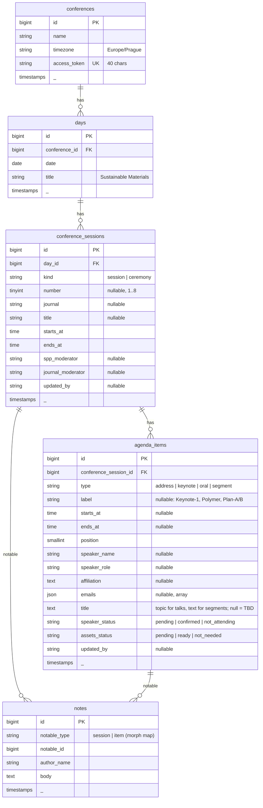

# Conference Schedule Board — System Design

> Living reference for building and running the team schedule board for the
> Science Park Publisher (SPP) online conference, 24–25 October 2026.
> Update this file whenever a decision changes.

---

## 1. Problem & Goal

The SPP team (researchers + 3 IT specialists acting as Zoom hosts) prepares a
two-day online conference with 8 journal sessions and ~38 speakers. Today the
schedule lives in a PDF that is edited, re-exported and re-posted to a WhatsApp
group after every change (we are on draft 8). Google Docs is live but has no
structure: you can't filter it, and statuses are just highlighted text.

**Goal:** one shared link where everyone sees the same schedule. Anyone can
update a speaker's confirmation, the assets status, the moderators, or add a
note in one or two clicks, and every change shows who made it.

### Who uses it

| Person | What they need |
|---|---|
| Researchers | Contact keynotes, mark Confirmed / Not attending, collect assets, assign moderators, leave notes |
| IT specialists (Zoom hosts) | See which assets are ready, and which speakers are absent so IT presents their assets instead |
| Coordinators | Overview: what is still pending, what is at risk |

### Glossary

| Term | Meaning |
|---|---|
| SPP | Science Park Publisher, the organizer |
| SPP moderator | SPP staff member who runs a session (e.g. Sara Ayman) |
| Journal moderator | Editor from the session's journal who moderates alongside SPP |
| Keynote | 15-minute invited talk |
| Assets | PowerPoint slides / videos played in the session; IT presents them if the speaker is absent |
| Plan-A / Plan-B | Fallback slot: discussion if time allows, otherwise poster video-graph |

---

## 2. Decisions

| Topic | Decision | Why |
|---|---|---|
| Access | One **secret team link** per conference (`/s/{token}`); no login | Fastest to share in WhatsApp; the 40-char token can't be guessed |
| Identity | Ask for the editor's name **once per device**, keep it in a long-lived cookie, show "Editing as Sara · change" | Every change is attributed without asking on every click |
| Live updates | **None.** Data refreshes after your own edits, on page reload, or with the Refresh button | Edit volume is low; avoids websockets and polling |
| Assets | **Status only** (no uploads, no links) | Files stay where the team already keeps them |
| Filters | Day → dependent Session, speaker search, speaker status, assets status. Kept in the URL | Shareable views, e.g. send IT "Day 2 · assets pending" |
| Scope | Built for this conference; the data model supports adding another conference later | No rewrite needed next time, no admin panel now |
| Schedule editing | Seeded from the PDF; the team can add, edit and delete sessions and items in the app | The PDF keeps changing |
| Stack | Laravel 12 · Inertia v2 · Svelte 5 (runes) · TypeScript · Tailwind v4 · MySQL | Requested; TypeScript keeps the status enums and data shapes in sync |

### Out of scope (on purpose)

User accounts and roles · real-time sync · file uploads · full activity history
· sending emails to speakers · drag-and-drop reordering · multiple languages ·
admin panel (conferences are created with an artisan command).

---

## 3. UX Design

### 3.1 Principles

1. **One page.** The whole conference is a single scrollable agenda, so there are no pages to navigate between.
2. **Status sits next to the record**, as on the PDF screenshot: each speaker row has a status column on the right.
3. **One click to change a status.** Click the pill, pick the new value, done. No forms for the common action.
4. **Problems stand out.** Neutral by default. Color appears only where action is needed (pending, at risk, missing moderator, topic TBD).
5. **Never lose an action.** If the editor name is missing, the name modal opens first and the original action then continues automatically.

### 3.2 Page anatomy (desktop)

```
┌───────────────────────────────────────────────────────────────────────────────┐
│ SCIENCE PARK PUBLISHER                                     Editing as Sara ▾  │
│ International Online Conference 2026                                          │
│ 24–25 October 2026 · Times in Prague time                Loaded 10:42 Refresh │
├───────────────────────────────────────────────────────────────────────────────┤
│  18/38 confirmed   9/38 assets ready   2 not attending   1 at risk   3 TBD    │  ← clickable counters
├───────────────────────────────────────────────────────────────────────────────┤
│ [ All | Day 1 | Day 2 ]  [ Session: All ▾ ]  [ ⌕ Search speaker…           ] │
│ [ Speaker: Any ▾ ]  [ Assets: Any ▾ ]          Showing 6 of 52 · Clear filters│
└───────────────────────────────────────────────────────────────────────────────┘

 DAY 1 · Saturday 24 October · Sustainable Materials · 09:00–15:30     (sticky)

┌ SESSION 1 · 09:30–11:00 ──────────────────────────────────────────── Edit ──┐
│ Integrated Nano (IN)                                                         │
│ Nanomaterials for Energy Harvesting & Sustainable Future                     │
│ SPP moderator  Sara Ayman         Journal moderator  Not assigned  (amber)   │
│                                                                    Notes (1) │
├─────────────┬──────────────────────────────────────────┬────────────────────┤
│ 09:30–09:45 │ KEYNOTE 1                                 │ Speaker ● Confirmed │
│             │ Prof. Nader Shahata                       │ Assets  ● Pending   │
│             │ Editor-in-Chief                           │                     │
│             │ Piezoelectric Nanocomposites: Horizon of… │ Notes (2) · Edit    │
│             │ nader83@vt.edu  Copy                      │ Noha · 2h ago       │
├─────────────┼──────────────────────────────────────────┼────────────────────┤
│ 09:45–10:00 │ KEYNOTE 2                                 │ Speaker ● Pending   │
│             │ Prof. Veera Rajendran                     │ Assets  ● Pending   │
│             │ Topic TBD  (amber)                        │ Notes · Edit        │
├─────────────┼──────────────────────────────────────────┼────────────────────┤
│ 10:45–11:00 │ Plan-A: Discussions & Closing (15 min)    │                     │
│             │ Plan-B: Video-graph of Posters            │ Notes · Edit        │
└─────────────┴──────────────────────────────────────────┴────────────────────┘
                                                            + Add item to session
```

- **Header:** conference name, dates, timezone note, editor chip (click to change name), "Loaded HH:MM · Refresh".
- **Summary bar:** counts for the current Day/Session scope. Clicking a counter applies the matching filter.
- **Day header:** sticky while scrolling through that day.
- **Session block:** number, time range, journal, title, both moderators, notes, Edit.
- **Item row:** three columns (time · details · status). Segments such as Plan-A/Plan-B, orals and closings use the same row, muted, with no status pills.

### 3.3 Mobile (WhatsApp link opened on a phone)

```
┌─────────────────────────────┐
│ SPP Conference 2026   Sara ▾│
│ [All|Day 1|Day 2] [Filters 2]│   ← "Filters" opens a bottom drawer
│ ⌕ Search speaker…           │
├─────────────────────────────┤
│ DAY 1 · Sat 24 Oct (sticky) │
│ SESSION 1 · 09:30–11:00     │
│ Integrated Nano (IN)        │
│ SPP: Sara Ayman             │
│ Journal: Not assigned       │
├─────────────────────────────┤
│ 09:30–09:45 · KEYNOTE 1     │
│ Prof. Nader Shahata         │
│ Piezoelectric Nanocomp…     │
│ [● Confirmed] [● Assets pending]
│ Notes (2) · Edit            │
└─────────────────────────────┘
```

On phones the time moves above the content, the pills sit side by side below
it, and the summary bar becomes a horizontally scrollable row.

### 3.4 Statuses

| Field | Values | Pill style |
|---|---|---|
| Speaker | **Pending** · **Confirmed** · **Not attending** | amber · emerald · rose |
| Assets | **Pending** · **Ready** (with the IT hosts) · *N/A* (segments, hidden) | amber · emerald |

Derived flags, computed on the client with no database column:

| Flag | Rule | Display |
|---|---|---|
| **At risk** | Not attending + assets pending | Rose left border on the row: "IT has nothing to present" |
| **IT presents** | Not attending + assets ready | Small muted badge "IT presents assets" |
| **Topic TBD** | Speaker item with no topic | Amber "Topic TBD" (like the yellow highlight in the PDF) |
| **Moderator missing** | Numbered session with an empty SPP or journal moderator | Amber "Not assigned" |

### 3.5 Interactions

| Action | Interaction |
|---|---|
| Change status | Click pill → small menu (dot + label + one-line hint) → select. Pill dims while saving → toast "Saved". |
| Notes | "Notes (n)" opens a modal: newest first, author + relative time, textarea at the bottom, "Add note". Delete asks for confirmation. Available on items and sessions. |
| Edit item / session | "Edit" opens a right-side drawer with a form. Moderators are edited here. Empty moderator fields show "Assign" as a link into the drawer. |
| Add | "+ Add item to session" at the end of each session; "+ Add session" at the end of each day. Both open the same drawer. |
| Delete | In the drawer footer, with confirmation naming the record ("Delete Keynote 2 – Prof. Veera Rajendran?"). |
| Editor name | First write action without a name → modal "What's your name? It will appear next to your changes." Saved → original action runs. |
| Copy email | Hovering an email shows "Copy" (useful for researchers contacting keynotes). |
| Stale edit guard | If someone changed the record after you loaded the page, saving the drawer shows "Updated by Noha at 10:42 — reloaded the latest version" instead of overwriting. |
| Keyboard | `/` focuses search · `Esc` closes modal/drawer/menu. |

### 3.6 Filters

- **Day:** segmented control `All | Day 1 | Day 2`.
- **Session:** select that depends on Day. With Day 1 selected it lists `Session 1 – Integrated Nano` … `Session 5`. With All it lists every session grouped by day. Changing Day resets Session.
- **Search:** matches speaker name, topic and email; case- and accent-insensitive; matches are highlighted.
- **Speaker status** and **Assets status** selects.
- All filters combine with AND. Sessions with no matching items are hidden. When no filter is active, every session is shown.
- State lives in the query string: `?day=1&session=12&q=nader&speaker=pending&assets=pending`. Updated with `replaceState` (no history spam, no server round-trip).
- Empty state: "No items match these filters · Clear filters".
- Filtering runs **client-side** (≈60 rows), so it is instant.

### 3.7 Visual language: official, premium, modern

- **Typography:** *Source Serif 4* for conference, day and session titles (academic, publisher feel). *Inter* for everything else. `tabular-nums` for times. Fonts are self-hosted via Fontsource (no Google Fonts requests).
- **Color:** warm off-white page (`stone-50`), white surfaces, hairline `stone-200` borders, deep ink-navy primary for text and actions. Status colors appear only in soft tinted pills (`bg-emerald-50 text-emerald-700 ring-1 ring-emerald-600/20`) with a small dot. Swap the primary color for SPP's brand color if they have one.
- **Shape and depth:** `rounded-lg`, almost no shadows (only on drawer, modal and menus), generous whitespace with dense, readable rows.
- **Labels:** small caps, letter-spaced labels ("KEYNOTE 1", "SPP MODERATOR") instead of icons.
- **Icons:** about 5 in total (search, chevron, close, refresh, copy), from `@lucide/svelte`. Actions use words ("Edit", "Notes"), not icon buttons.
- **Motion:** 150 ms fades and slides for menus, drawer and toasts only.
- **Accessibility:** contrast ≥ 4.5:1, visible focus rings, status is never conveyed by color alone (always a label), dialogs trap focus.

Tokens live in `resources/css/app.css` via Tailwind v4 `@theme`:

```css
@theme {
  --font-sans: "Inter Variable", ui-sans-serif, system-ui, sans-serif;
  --font-serif: "Source Serif 4 Variable", ui-serif, Georgia, serif;
  --color-ink-950: #0b1426;
  --color-ink-900: #13213d;
  --color-ink-700: #2a3b5f;
  --color-ink-500: #5b6b8c;
}
```

---

## 4. Architecture

```
Browser (Svelte 5 + TS)  ──Inertia──▶  Laravel 12  ──▶  MySQL
  one page: Schedule/Show              controllers + form requests
  client-side filtering                Eloquent models + enums
```

- **Inertia v2**: Laravel controllers return `Inertia::render('Schedule/Show', [...])`. Writes are normal Inertia `router.patch/post/delete` calls that redirect back with a flash message, using `preserveScroll` and `preserveState`. Every write reloads the props, so after each save the editor also sees everyone else's latest changes.
- **No API layer, no queue, no websockets.** `QUEUE_CONNECTION=sync` is fine.
- **Payload:** the whole conference tree (days → sessions → items → notes) is sent in one prop. It is small (< 100 KB), and loading it all lets filtering and notes work instantly.

### 4.1 Data model



Notes on the model:

- **The table is** `conference_sessions`**, not** `sessions`**.** Laravel's database session driver already uses `sessions`, and `Session` would clash with the facade. Model: `ConferenceSession`.
- **Statuses are** `string` **columns cast to PHP backed enums**, not MySQL `ENUM` columns, so adding a value later doesn't need an `ALTER`.
- **Ordering:** sessions by `starts_at`; items by `starts_at` (nulls last), then `position`. Session 4 orals have no individual times, so `position` keeps them in order. New items get `max(position) + 1`.
- **Speakers are stored on the item, not in a** `people` **table.** The same keynote doesn't appear twice, so a separate table would only add joins.
- **Attribution:** `updated_by` on sessions and items plus `author_name` on notes, combined with `updated_at`, is enough for "Noha · 2h ago". There is no history table (activity log is out of scope).
- **Day number** ("Day 1") is derived from date order and not stored.
- Indexes: FKs, `conferences.access_token` unique, `agenda_items (conference_session_id, position)`, `notes (notable_type, notable_id)` (from `morphs()`).
- `Relation::enforceMorphMap(['session' => ConferenceSession::class, 'item' => AgendaItem::class])`.

### 4.2 Enums (PHP ⇄ TypeScript)

```php
enum SpeakerStatus: string { case Pending = 'pending'; case Confirmed = 'confirmed'; case NotAttending = 'not_attending'; }
enum AssetsStatus: string  { case Pending = 'pending'; case Ready = 'ready'; case NotNeeded = 'not_needed'; }
enum AgendaItemType: string { case Address = 'address'; case Keynote = 'keynote'; case Oral = 'oral'; case Segment = 'segment'; }
enum SessionKind: string   { case Session = 'session'; case Ceremony = 'ceremony'; }
```

```ts
// resources/js/types/models.ts
export type SpeakerStatus = 'pending' | 'confirmed' | 'not_attending';
export type AssetsStatus = 'pending' | 'ready' | 'not_needed';
export type AgendaItemType = 'address' | 'keynote' | 'oral' | 'segment';
export type SessionKind = 'session' | 'ceremony';

export interface Note { id: number; author_name: string; body: string; created_at: string }

export interface AgendaItem {
  id: number;
  type: AgendaItemType;
  label: string | null;
  starts_at: string | null; // "09:30"
  ends_at: string | null;
  speaker_name: string | null;
  speaker_role: string | null;
  affiliation: string | null;
  emails: string[];
  title: string | null;
  speaker_status: SpeakerStatus;
  assets_status: AssetsStatus;
  updated_by: string | null;
  updated_at: string;
  notes: Note[];
}

export interface ConferenceSession {
  id: number;
  kind: SessionKind;
  number: number | null;
  journal: string | null;
  title: string | null;
  starts_at: string;
  ends_at: string;
  spp_moderator: string | null;
  journal_moderator: string | null;
  updated_by: string | null;
  updated_at: string;
  items: AgendaItem[];
  notes: Note[];
}

export interface Day { id: number; number: number; date: string; title: string; sessions: ConferenceSession[] }
export interface Conference { id: number; name: string; timezone: string; token: string; days: Day[] }
```

Props keep snake_case end to end (no mapping layer). PHP serializes through
`JsonResource` classes with `JsonResource::withoutWrapping()`, so exactly the
fields above are exposed.

### 4.3 Routes

All routes are scoped by the conference token. Write routes use the `editor`
middleware and `throttle:60,1`.

| Method | URI | Controller | Purpose |
|---|---|---|---|
| GET | `/` | — | Plain page: "Ask your team for the schedule link" |
| GET | `/s/{conference:access_token}` | `ScheduleController@show` | The board |
| POST | `/s/{token}/editor` | `EditorController@store` | Save editor name (cookie) |
| POST | `/s/{token}/sessions` | `ConferenceSessionController@store` | Add session |
| PUT | `/s/{token}/sessions/{session}` | `ConferenceSessionController@update` | Edit session details and moderators |
| DELETE | `/s/{token}/sessions/{session}` | `ConferenceSessionController@destroy` | Delete session (and its items) |
| POST | `/s/{token}/sessions/{session}/items` | `AgendaItemController@store` | Add item |
| PUT | `/s/{token}/items/{item}` | `AgendaItemController@update` | Edit item details |
| PATCH | `/s/{token}/items/{item}/status` | `AgendaItemStatusController@update` | Quick status change |
| DELETE | `/s/{token}/items/{item}` | `AgendaItemController@destroy` | Delete item |
| POST | `/s/{token}/notes` | `NoteController@store` | Add note (`notable_type`, `notable_id`) |
| DELETE | `/s/{token}/notes/{note}` | `NoteController@destroy` | Delete note |

**Scoping rule:** child records are always looked up *through* the conference
(e.g. `AgendaItem::forConference($conference)->findOrFail($id)`). A token for
one conference can never reach another conference's rows. A test covers this.

### 4.4 Backend building blocks

- **Middleware** `EnsureEditorName` (write routes): reads the `editor_name` cookie. If it is missing, it redirects back with an `editor_name` error, and the frontend opens the name modal. The frontend normally asks first; this is the safety net.
- `EditorController@store`: validates `name` (required, 2–60 chars) and sets `Cookie::forever('editor_name', …)`. Laravel cookies are encrypted.
- **Form Requests:** `StoreSessionRequest`, `UpdateSessionRequest`, `StoreAgendaItemRequest`, `UpdateAgendaItemRequest`, `UpdateAgendaItemStatusRequest` (`speaker_status`/`assets_status` as `sometimes` + `Rule::enum`), `StoreNoteRequest`.
- **Stale guard:** `Update*Request` requires `expected_updated_at`. If the record's `updated_at` differs, the request fails validation with "Updated by {name} at {time}". Status changes skip this guard (single-value, intentional clicks; last write wins).
- `HandleInertiaRequests` **shared props:** `editor: { name }`, `flash: { success }`.
- **Artisan:** `php artisan conference:link {conference?} {--rotate}` prints the team URL and, with `--rotate`, generates a new token (use it if the link leaks).
- **Privacy:** `<meta name="robots" content="noindex, nofollow">`, `<meta name="referrer" content="no-referrer">`, and `Disallow: /` in `robots.txt`.

### 4.5 Frontend structure

```
resources/
  css/app.css                      Tailwind v4 + @theme tokens + fonts
  views/app.blade.php              Inertia root (@vite, @inertiaHead, @inertia)
  js/
    app.ts                         createInertiaApp + Svelte 5 mount()
    types/models.ts                shared types (section 4.2)
    types/inertia.d.ts             typed shared page props
    lib/
      routes.ts                    tiny typed URL helpers (≈10 routes, no Ziggy)
      filters.ts                   pure filter + URL (de)serialization
      stats.ts                     summary counts + derived flags
      editor.svelte.ts             requireEditor(action): opens name modal if needed, then runs action
      format.ts                    time ranges, relative time, accent-insensitive normalize
    Pages/
      Home.svelte                  "ask for the link"
      Schedule/Show.svelte         the board
    Components/
      layout/AppHeader.svelte
      schedule/SummaryBar.svelte
      schedule/FilterBar.svelte
      schedule/DaySection.svelte
      schedule/SessionBlock.svelte
      schedule/AgendaItemRow.svelte
      schedule/StatusMenu.svelte
      schedule/NotesModal.svelte
      schedule/SessionDrawer.svelte
      schedule/ItemDrawer.svelte
      schedule/EditorNameModal.svelte
      ui/ (Button, Pill, Select, Input, Textarea, Modal, Drawer, ConfirmDialog, Toast)
```

- **Svelte 5 runes** (`$state`, `$derived`, `$props`). Filter state is `$state` in `Show.svelte`; the visible tree is `$derived` from the props and the filters.
- **Headless primitives:** `bits-ui` for Dialog, Popover/DropdownMenu and Select (focus trap, keyboard, aria), styled with Tailwind. Nothing else UI-related.
- **Forms:** Inertia `useForm` in drawers (gives errors and processing state).
- `filters.ts` and `stats.ts` are pure functions, so they are easy to unit-test.

### 4.6 Packages

| Side | Package | Purpose |
|---|---|---|
| PHP | `inertiajs/inertia-laravel` ^2 | Inertia server adapter |
| JS | `@inertiajs/svelte` ^2, `svelte` ^5, `@sveltejs/vite-plugin-svelte` | Svelte + Inertia |
| JS | `typescript`, `svelte-check`, `@tsconfig/svelte` | Types |
| JS | `bits-ui` | Accessible headless primitives |
| JS | `@lucide/svelte` | The few icons we use |
| JS | `@fontsource-variable/inter`, `@fontsource-variable/source-serif-4` | Self-hosted fonts |
| JS (dev) | `vitest` | Unit tests for `filters.ts` / `stats.ts` |

Already present: Laravel 12, Tailwind v4 (`@tailwindcss/vite`), Vite 7, PHPUnit 11, Pint.

---

## 5. Environment & Testing

| Item | Value |
|---|---|
| Local DB server | MariaDB 10.4 (XAMPP), driver `mysql` |
| App DB | `schedule_app` (already in `.env`) |
| Test DB | `schedule_app_test` (created, utf8mb4_unicode_ci) |
| Production DB | MySQL 8 or MariaDB 10.11+ recommended (10.4 is end-of-life) |

`phpunit.xml` must point tests at the test DB so `RefreshDatabase` never touches real data:

```xml
<env name="DB_CONNECTION" value="mysql"/>
<env name="DB_DATABASE" value="schedule_app_test"/>
```

**Test strategy (no more than needed):**

- **Feature tests (PHPUnit):** board loads with a valid token and returns 404 for a wrong one. Writes without an editor name are rejected. A status change persists and records `updated_by`. Validation errors. The stale guard rejects outdated edits. Notes can be created and deleted. A record from another conference returns 404. The seeder produces the expected counts.
- **Unit tests (Vitest):** filter combinations, the dependent session list, accent-insensitive search, summary counts and derived flags.
- **Static checks:** `svelte-check` (types), `pint` (PHP style).

---

## 6. Seed Data (from draft 8 PDF)

Seeder: `database/seeders/Spp2026ConferenceSeeder.php`. Data is kept as a plain
PHP array mirroring the PDF, all statuses start as `pending`, and "Topic: TBD"
is stored as `null`.

**Expected counts:** 2 days · 8 numbered sessions + ceremonies/closings · 32
keynotes · 2 opening addresses · 4 orals (Session 4) · segment rows for
Plan-A/B, orals and discussions.

**Data issues in the PDF, fixed while seeding:**

| PDF | Seed as |
|---|---|
| Session 6: "11:45–11:30 am" | 10:45–11:30 |
| Session 2: "12:00 am–12:15 pm" | 12:00–12:15 |
| Session 4 talks have no individual times | `starts_at = null`, ordered by `position` |
| Session 6 has two journal moderators (Magda EL-Massik for the first half, Maged Wasfy from 10:00) | `journal_moderator`: "Prof. Magda EL-Massik (09:00–10:00) · Prof. Maged Wasfy (10:00–11:30)" |
| Session 4 has no SPP moderator | Left empty, so it shows "Not assigned" |
| "Editorial Borad Member", "Editor in-Cheif" | Spelling corrected |
| Session 4 Computer: "??? Dr. Hesham (Editor in-Chief: Frag (WhatsApp) & Hazem Bakery)" | Speaker "Dr. Hesham" plus this text as a note |
| Dr. Ahmed Mourtada Elseman / Prof. Hesham Hamed / Prof. Ahmed Samir Sultan have 2 emails | `emails` array |

> **Timezone heads-up:** the PDF labels both days "CET", but Europe switches
> to winter time at 03:00 on **Sunday 25 Oct 2026**. Day 1 is CEST (UTC+2) and
> Day 2 is CET (UTC+1). For the team in Cairo (UTC+3 on both days), Prague
> 09:00 is 10:00 on Day 1 and **11:00 on Day 2**. The app shows times exactly
> as the PDF does (Prague time); the header says "Prague time", and the Day 2
> header carries a small "Winter time begins (UTC+1)" note.

---

## 7. Implementation Phases

Each phase ends in a working, testable state. Tick boxes as we go.

### Phase 0: Foundations

- [ ] `git init` + first commit of the skeleton
- [ ] Install `inertiajs/inertia-laravel`; publish and register `HandleInertiaRequests`
- [ ] Install Svelte 5, `@inertiajs/svelte`, `@sveltejs/vite-plugin-svelte`, TypeScript, `svelte-check`
- [ ] `vite.config.js` → `vite.config.ts` with `svelte()` + `tailwindcss()` + `laravel({ input: ['resources/css/app.css', 'resources/js/app.ts'] })`
- [ ] `tsconfig.json`, `svelte.config.js`, `resources/js/app.ts`, `resources/views/app.blade.php`; remove `welcome.blade.php` and `app.js`/`bootstrap.js` (axios not needed)
- [ ] Fonts + `@theme` tokens in `app.css`
- [ ] `phpunit.xml` → `schedule_app_test`
- [ ] `composer.json` scripts: `npm run check` (svelte-check) and `vitest`
- [ ] `Home.svelte` renders through Inertia

**Done when:** `composer dev` serves an Inertia + Svelte page styled with the tokens; `php artisan test` and `npm run check` pass.

### Phase 1: Data model & seed

- [ ] Migrations: `conferences`, `days`, `conference_sessions`, `agenda_items`, `notes`
- [ ] Enums, models, relations, casts, `forConference` scopes, morph map
- [ ] Factories for each model
- [ ] `Spp2026ConferenceSeeder` with the PDF data and the fixes from section 6
- [ ] `conference:link {--rotate}` command
- [ ] Tests: seeder counts, token rotation

**Done when:** `php artisan migrate:fresh --seed` then `php artisan conference:link` prints a working URL.

### Phase 2: Read-only board

- [ ] Routes, `ScheduleController@show`, JSON resources, typed props
- [ ] `AppHeader`, `DaySection` (sticky), `SessionBlock`, `AgendaItemRow` with read-only pills
- [ ] Derived flags (at risk, IT presents, topic TBD, moderator missing) in `stats.ts`
- [ ] `SummaryBar`
- [ ] Responsive layout (desktop three columns, mobile stacked)
- [ ] `noindex` + `no-referrer` meta, `robots.txt`
- [ ] Tests: valid token 200, wrong token 404

**Done when:** the shared link shows the full conference matching the PDF, on desktop and phone.

### Phase 3: Filters & search

- [ ] `filters.ts`: Day → dependent Session, search, speaker status, assets status
- [ ] `FilterBar` (desktop inline, mobile drawer) + URL sync via `replaceState`
- [ ] Summary counters apply filters; "Showing X of Y · Clear filters"; empty state
- [ ] Search highlight; `/` shortcut
- [ ] Vitest for `filters.ts` and `stats.ts`

**Done when:** "Day 1 → Session 2 → assets pending" works and the URL can be pasted into another browser to reproduce the view.

### Phase 4: Editor identity & quick status changes

- [ ] `EditorController`, `EnsureEditorName` middleware, shared `editor` prop
- [ ] `EditorNameModal`, header "Editing as … · change", `requireEditor(action)` helper
- [ ] `StatusMenu` + `PATCH items/{item}/status`; `updated_by` set from the cookie
- [ ] Toast on flash success; "Noha · 2h ago" line on rows
- [ ] "Loaded HH:MM · Refresh" in the header
- [ ] Tests: write without name rejected, status persists with `updated_by`, cross-conference 404

**Done when:** a first-time visitor clicks a pill, enters their name once, and the change saves and shows their name.

### Phase 5: Notes

- [ ] `NoteController` store/destroy (items and sessions)
- [ ] `NotesModal`: list, add, delete with confirmation; "Notes (n)" counts
- [ ] Tests: create, delete, validation, scoping

**Done when:** anyone can read and add notes on any keynote or session from the modal.

### Phase 6: Editing the schedule

- [ ] `SessionDrawer`: kind, number, journal, title, times, SPP moderator, journal moderator
- [ ] `ItemDrawer`: type-aware fields (segments hide speaker fields and status)
- [ ] Add session (per day), add item (per session), delete with confirmation
- [ ] Stale guard via `expected_updated_at`
- [ ] Tests: create/update/delete, validation, stale rejection

**Done when:** the team can make every kind of change the PDF drafts needed without touching code.

### Phase 7: Polish & launch

- [ ] Accessibility pass (keyboard-only run-through, contrast, focus)
- [ ] Mobile pass on a real phone via the WhatsApp in-app browser
- [ ] Print stylesheet (`print:` variants) so a clean PDF can still be produced from the browser
- [ ] Production `.env` (`APP_DEBUG=false`, HTTPS `APP_URL`), `npm run build`, `php artisan optimize`
- [ ] Seed production, generate the link, share it in the team group

**Done when:** the team uses the link instead of PDF drafts.

---

## 8. Open Questions / Assumptions

1. **Assets states:** assumed two states, *Pending* and *Ready* (= received and handed to the IT hosts). Should there be a middle step, *Received* (collected but not yet sent to IT)?
2. **Official conference name** for the header, and whether SPP has a **logo / brand color** to replace the ink-navy primary.
3. **Hosting:** where it will be deployed (any PHP 8.2 + MySQL host works; no queue worker or websockets needed).
4. **IT host per session:** not included now. Easy to add later as one `zoom_host` column on sessions if useful.
5. **Local time display** (e.g. Cairo time next to Prague time): not included. The data model (date + time + conference timezone) supports adding it later.
